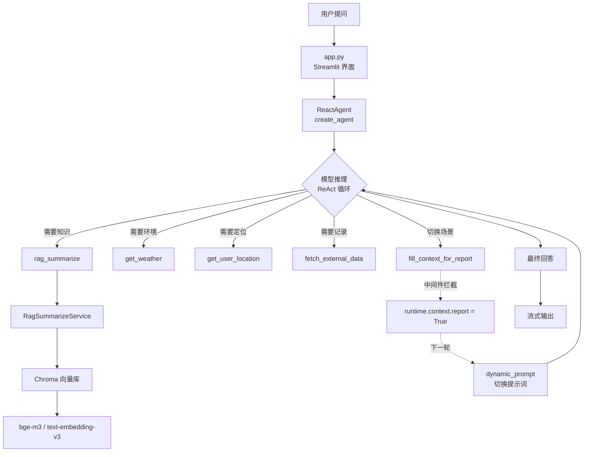
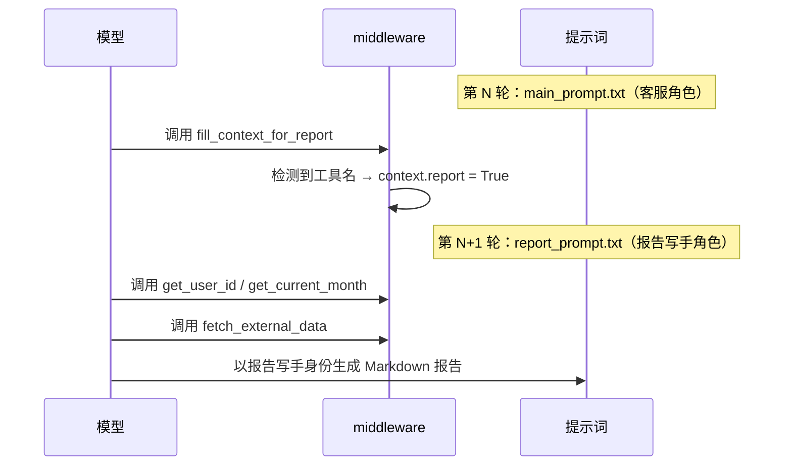

# 企业级 RAG + Agent 智能客服系统

一个面向扫地机器人售后场景的 **Agentic RAG** 应用。基于 LangChain 1.x 与 LangGraph 构建，模型可依据用户意图自主编排工具，而非执行固定流程。

> 与常规 RAG Demo 的区别：RAG 检索在这里只是一个**可被 Agent 调用的工具**，而非固定的两段式流程；同时通过 middleware 实现了「客服 / 报告写手」两个角色的动态切换。

---

## 核心特性

- **Agent 自主编排**：7 个工具注册给 LLM，由模型决定调用顺序与次数，支持 ReAct 多轮思考循环
- **RAG 全链路**：文档加载 → 文本切分 → 向量化 → Chroma 持久化 → 相似度检索 → 上下文拼接 → 提示词组装
- **动态提示词切换**：以「空工具 + 中间件标记」作为状态信号，实现同一 Agent 在两种角色间切换，规避多套指令冲突
- **三类中间件钩子**：工具调用监控、模型调用前观测、提示词动态注入
- **工程化**：YAML 分层配置、提示词与代码分离、模型工厂复用实例、控制台/文件双通道分级日志
- **幂等入库**：文件级 MD5 去重，避免重复上传导致向量库污染

---

## 架构



### 动态提示词切换时序



> 关键点：信号在第 N 轮发出，第 N+1 轮才生效。因此主提示词中必须强制模型**先**调用该工具。

---

## 技术栈

| 层次 | 技术 |
|---|---|
| Agent 框架 | LangChain 1.3 / LangGraph 1.2（`create_agent` + middleware） |
| 向量检索 | Chroma 1.5、text-embedding-v3 |
| 大模型 | 通义千问 qwen-plus（DashScope） |
| 文档解析 | pypdf、LangChain TextLoader |
| 前端 | Streamlit |
| 配置 | YAML + python-dotenv |

---

## 快速开始

### 1. 克隆与安装

```bash
git clone https://github.com/<your-name>/<repo-name>.git
cd <repo-name>

python -m venv venv
# Windows
venv\Scripts\activate
# macOS / Linux
source venv/bin/activate

pip install -r requirements.txt
```

### 2. 配置 API Key

复制示例配置并填入真实密钥：

```bash
# Windows
copy .env.example .env
# macOS / Linux
cp .env.example .env
```

编辑 `.env`：

```ini
DASHSCOPE_API_KEY=sk-你的真实密钥
```

> 密钥获取：阿里云百炼控制台 → API-KEY 管理。
> `.env` 已被 `.gitignore` 忽略，不会进入版本库。

### 3. 构建知识库

首次运行需要把 `data/` 下的文档向量化入库：

```bash
python rag/vector_store.py
```

该脚本会读取 `data/` 下的 txt / pdf，切分后写入 `chroma_db/`，并记录 MD5 指纹避免重复入库。

### 4. 启动应用

```bash
streamlit run app.py
```

浏览器打开 `http://localhost:8501` 即可对话。

---

## 项目结构

```
.
├── app.py                      # Streamlit 入口，流式对话界面
├── test_model.py               # 对照实验：手写 ReAct 循环（理解框架内部机制）
│
├── config/                     # 配置层（与代码分离）
│   ├── agent.yml               # 外部数据路径
│   ├── chroma.yml              # 向量库参数：collection / k / chunk / 文件白名单
│   ├── prompts.yml             # 提示词文件路径映射
│   └── rag.yml                 # 模型名称（不存密钥）
│
├── prompts/                    # 提示词正文（可作为资产独立迭代）
│   ├── main_prompt.txt         # 主 Agent 行为规范（客服角色）
│   ├── rag_summarize.txt       # RAG 总结角色
│   └── report_prompt.txt       # 报告写手角色
│
├── model/
│   └── factory.py              # 模型工厂，产出 chat_model / embed_model 单例
│
├── utils/                      # 基础层
│   ├── path_tool.py            # 工程根目录与绝对路径
│   ├── config_handler.py       # YAML 加载
│   ├── logger_handler.py       # 双 Handler 分级日志
│   ├── file_handler.py         # 文件 MD5 / PDF / Text 加载器
│   └── prompt_loader.py        # 提示词读取
│
├── rag/                        # RAG 子模块
│   ├── vector_store.py         # Chroma 封装 + 离线入库（含去重）
│   └── rag_service.py          # 检索 → 拼接 → 总结链
│
├── agent/
│   ├── react_agent.py          # Agent 组装：模型 + 工具 + 中间件
│   └── tools/
│       ├── agent_tools.py      # 7 个工具定义
│       └── middleware.py       # 3 个中间件钩子
│
└── data/                       # 知识库原文与外部业务数据
```

---

## 核心设计说明

### 1. 为什么把 RAG 做成工具

传统 RAG 是「每次都检索 → 塞进提示词 → 生成」。但用户问「今天适合用扫地机器人吗」时，需要的是天气而非知识库。

把检索降格为普通工具后，模型可以自主判断：查知识库、查天气、查使用记录，或直接回答。

代码上只有三行：

```python
rag = RagSummarizeService()

@tool(description="从向量存储中检索参考资料")
def rag_summarize(query: str) -> str:
    return rag.rag_summarize(query)
```

收益是能力解耦 —— RAG 服务可独立运行与测试，不必每次走完整 Agent 链路。

### 2. 为什么用「空工具」做状态信号

要判断用户是否想生成报告，有两个方案：代码里匹配关键词（脆弱），或让模型自己记住（不可靠）。

采用的方案是：定义一个不产生任何数据的工具，模型调用它就等于「显式发出了一个可被拦截的信号」。

```python
@tool(description="无入参，调用后触发中间件注入上下文信息")
def fill_context_for_report():
    return "fill_context_for_report已调用"
```

中间件捕获后写入 `runtime.context`，下一轮 `@dynamic_prompt` 读取并切换提示词。

**判断权交给模型（理解语义），切换权交给中间件（确定性执行）** —— 各做擅长的事。

### 3. 检索链的上下文拼接

```python
context += f"[参考资料{counter}]:{doc.page_content} | 元数据：{doc.metadata}\n"
```

带编号与元数据，便于模型引用出处，也便于排查「检索到了什么」。

---

## 注意事项

- **密钥安全**：仓库内不含任何密钥，请通过 `.env` 配置。若曾提交过密钥，请立即在控制台吊销重置。
- **向量库不入库**：`chroma_db/` 被忽略，克隆后需先运行 `python rag/vector_store.py` 重建。
- **成本**：Agent 多轮调用会消耗较多 token，主提示词中已限制「5 次工具调用后仍信息不足则回复不知道」。
- **已知限制**：当前版本未接入会话持久化（无 `thread_id`），多轮对话上下文不跨请求保留；`stream_mode="values"` 为消息级流式，非 token 级流式。

---

## License

MIT
